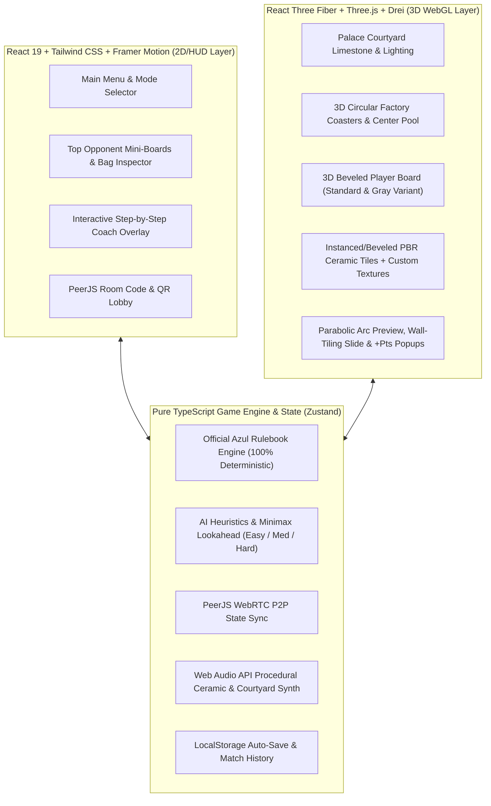

# Azul: Royal Palace of Évora — 3D Mobile Game Design & Implementation Plan

> [!IMPORTANT]
> **Design & Mockup Approval Checkpoint**
> Below are the initial **Nano Banana 3D Game Design, Layout, and Tactile Asset Mockups** alongside the complete engineering plan and milestones. Once you approve the visual direction and plan, you can copy and run the `/goal` command provided in the chat to kick off autonomous execution!

---

## 1. Nano Banana 3D Visual Mockups

````carousel

<!-- slide -->

<!-- slide -->

````

### Visual & UX Highlights from the Mockups
1. **Single-Screen 9:16 Portrait Ergonomics**:
   - **Top Zone (18% height)**: Ornate Moorish brass-framed HUD featuring live opponent mini-boards (showing their 5×5 wall, pattern lines, floor penalties, and score), current turn indicator, menu drawer, and interactive **3D Linen Tile Bag / Box Lid Inspector**. Tapping any opponent mini-board smoothly zooms/expands a 3D inspection modal.
   - **Middle Zone (38% height)**: Sun-drenched carved Portuguese limestone & terracotta courtyard table holding 5, 7, or 9 circular 3D Factory Displays around the central pool and the `"1"` Starting Player ceramic token.
   - **Bottom Zone (44% height)**: Active player's 3D wooden & ceramic board tilted at an ergonomic angle, showcasing the 5 stair-step **Pattern Lines** (right-to-left placement), the **5×5 Wall** (Colored Standard or Gray Variant), and the **7-slot Floor Line** (`-1, -1, -2, -2, -2, -3, -3`).
2. **Dual Touch Mechanics (Tap-to-Select + 3D Drag-and-Drop)**:
   - Tapping or dragging a color group from a Factory or the Center lifts the matching 3D beveled ceramic tiles, projects a golden parabolic arc to valid Pattern Lines, and displays a live **`+X pts` / `-Y penalty` preview badge** before confirming.
   - Includes a pre-confirmation **Undo Move** button before finalizing turn handoff (in single-player/local play).

---

## 2. System Architecture & Tech Stack



- **Framework**: Vite + React 19 + TypeScript (strict mode) + PWA (`vite-plugin-pwa`) for full offline & home-screen mobile installation.
- **3D Rendering**: Three.js + `@react-three/fiber` + `@react-three/drei` + `@react-three/postprocessing` (bloom on scoring chains, contact shadows, physically based `MeshPhysicalMaterial` with clearcoat for high-gloss ceramic glaze).
- **Nano Banana Asset Pipeline**: Seamless 2D/PBR textures generated via `image-generator` subagents for each of the 5 authentic azulejo tile faces, the `"1"` starting player token, the circular terracotta/blue-scrollwork factory display coaster, limestone tabletop, and UI medallions.
- **State Management**: Zustand store with immutable state transitions, deterministic PRNG seed support (for P2P sync and undo), and `localStorage` auto-save.
- **Networking**: `peerjs` (WebRTC P2P data channels) using short 5-character room codes (e.g., `AZUL-7X9K`) and one-tap shareable URLs/QR codes—zero backend servers required.

---

## 3. Subagent Orchestration Strategy

During execution, we will parallelize work across specialized subagents:
1. **`image-generator` (Nano Banana Asset Subagents)**:
   - Generate seamless, crop-aligned top-down textures for all 5 tile colors (`cobalt_blue`, `sun_yellow`, `terracotta_red`, `onyx_black`, `sky_teal`), the `"1"` first-player tile, the circular Moorish factory plate texture, and palace courtyard environment textures.
2. **Engine & AI Subagent (`self`)**:
   - Build and unit-test the pure TypeScript Azul rules engine (`src/engine/`) and the 3-tier AI evaluation engine (`src/ai/`) with Vitest suite verifying every edge case in the rulebook.
3. **3D Scene & Shader Subagent (`self`)**:
   - Build the React Three Fiber 3D components (`RoundedBox` beveled ceramic tiles with clearcoat glaze, recessed board slots, parabolic arc trajectories, camera rig, and step-by-step wall-tiling animations).
4. **UI, Audio, Tutorial & Multiplayer Subagent (`self`)**:
   - Build the Moorish HUD, Opponent Mini-Board Drawer, Bag/Lid Probability Inspector, Interactive Tutorial, Web Audio API ceramic sound synthesizer, and PeerJS room code lobby.

---

## 4. Comprehensive Milestones & Task Breakdown

### Milestone 1: Project Scaffolding & Nano Banana Production Texture Suite
- [x] **1.1**: Initialize Vite + React + TypeScript project in `c:\Development\Azulejo` with Three.js, `@react-three/fiber`, `@react-three/drei`, `zustand`, `framer-motion`, `peerjs`, `lucide-react`, `canvas-confetti`, and `vitest`.
- [x] **1.2**: Launch `image-generator` (Nano Banana) subagents to render production-ready, top-down square textures (`public/textures/`) for:
  - Tile 1: Deep Cobalt Blue glazed ceramic
  - Tile 2: Golden Yellow & Blue Moorish floral azulejo
  - Tile 3: Terracotta Coral Red glazed ceramic
  - Tile 4: Onyx Black & Teal Moorish star azulejo
  - Tile 5: Sky Blue & White starburst azulejo
  - Token 6: White & Cobalt `"1"` Starting Player marker
  - Coaster: Circular terracotta & blue-and-white painted Moorish Factory Display plate
  - Surface: Carved Évora limestone & terracotta courtyard border texture
- [x] **1.3**: Configure mobile viewport meta tags, touch-action locks (`touch-action: none` on canvas), safe-area insets, and PWA manifest.

### Milestone 2: Deterministic Azul Core Rules Engine & Unit Test Suite
- [x] **2.1**: Implement complete data models (`GameState`, `PlayerBoard`, `PatternLine`, `WallGrid`, `FloorLine`, `FactoryDisplay`, `CenterPool`, `TileColor`, `GamePhase`, `WallMode`).
- [x] **2.2**: Implement **Setup Rules** (Page 2):
  - 2 players → 5 Factory displays; 3 players → 7 Factory displays; 4 players → 9 Factory displays.
  - 100 tiles (20 of each of the 5 colors) in the Bag; draw 4 tiles per Factory display; place Starting Player marker in the center.
- [x] **2.3**: Implement **Phase A: Factory Offer** (Pages 3–4):
  - Pick all tiles of a single color from one Factory (move remaining tiles to Center) OR pick all tiles of a single color from the Center (if first player to pick from Center this round, automatically take the `"1"` marker onto leftmost free Floor Line slot).
  - Pattern Line placement validation: right-to-left filling, single color per line, cannot place a color in row $r$ if row $r$ of the Wall already contains that color.
  - Variant Play (Gray Wall) validation: when placing onto the Gray Wall, players may choose any open column in row $r$, provided that column does not already contain that color vertically! Also ensure pattern line legality checks respect remaining valid wall columns.
  - Overflow / voluntary Floor Line placement: excess tiles fill the 7 Floor Line slots (`[-1, -1, -2, -2, -2, -3, -3]`) from left to right; any further overflow goes directly to the Box Lid discard pile.
- [x] **2.4**: Implement **Phase B: Wall-Tiling & Step-by-Step Scoring Events** (Pages 4–5):
  - Process rows 1 to 5 top-to-bottom. Move rightmost tile of complete lines to the Wall.
  - Generate discrete `ScoringStepEvent` objects for each tile placed:
    - Isolated tile = `1 pt`.
    - Horizontally linked contiguous chain = `length of horizontal chain` pts.
    - Vertically linked contiguous chain = `length of vertical chain` pts.
    - Both horizontal & vertical chains = `H_length + V_length` pts (counting the newly placed tile in both!).
  - Move remaining tiles from completed Pattern Lines to the Box Lid; keep incomplete Pattern Lines intact.
  - Deduct Floor Line penalties (`-1, -1, -2, -2, -2, -3, -3`, clamped so score never drops below `0`), move Floor tiles to Box Lid, and keep the `"1"` marker with the player who took it.
- [x] **2.5**: Implement **Phase C: Preparing Next Round & End-of-Game Triggers** (Pages 5–6):
  - Check if at least one player has completed a horizontal line of 5 consecutive tiles on their Wall.
  - If continuing: refill Factories from Bag; if Bag empties mid-deal, refill Bag from Box Lid and continue filling; handle the rare edge case where both Bag and Box Lid are empty.
  - If game ends: compute End-of-Game bonuses (`+2 pts` per complete horizontal line of 5, `+7 pts` per complete vertical line of 5, `+10 pts` per color with all 5 tiles placed on the wall) and resolve tie-breakers (most complete horizontal lines, otherwise shared victory).
- [x] **2.6**: Write comprehensive Vitest unit tests covering every rulebook example (Peter, Martin, Andrea examples from Pages 3–5, Gray Wall variant rules, Bag refill from Box Lid, and floor clamping at 0).

### Milestone 3: 3D Scene Architecture, PBR Ceramic Shaders & Responsive Mobile Camera
- [x] **3.1**: Build the Three.js / React Three Fiber `AzulejoCanvas` with warm directional Iberian sunlight, soft shadow maps, and an environment map for realistic specular glaze reflections on the tiles.
- [x] **3.2**: Create `Tile3D` component using beveled `RoundedBox` geometry, `MeshPhysicalMaterial` (`clearcoat: 1.0`, `clearcoatRoughness: 0.08`, `roughness: 0.15`), and the Nano Banana azulejo textures.
- [x] **3.3**: Create `FactoryDisplay3D` (circular terracotta coaster with painted Moorish rim holding up to 4 tiles in a 2×2 grid) and `CenterPool3D` (central court area dynamically arranging pooled tiles by color group plus the `"1"` marker).
- [x] **3.4**: Create `PlayerBoard3D` featuring carved wood/ceramic frame, 5 recessed Pattern Lines, 5×5 Wall grid (with dimmed ghost textures in Standard Mode and clean slate recesses with column-constraint indicators in Gray Variant Mode), and 7 Floor Line slots with penalty badges.
- [x] **3.5**: Configure responsive mobile portrait camera framing that automatically adapts aspect ratio so the Top HUD, Middle Factory Circle (5, 7, or 9 factories), and Bottom Active Player Board fit cleanly without clipping on any phone or tablet screen.

### Milestone 4: Touch Interactions, Parabolic Arc Previews & Animated Wall-Tiling
- [x] **4.1**: Implement dual **Tap-to-Select** and **3D Drag-and-Drop**:
  - Selecting a tile color in a Factory or Center elevates those tiles in 3D space with a warm golden rim glow.
  - Valid destination Pattern Lines highlight in emerald/gold and display a floating **`+X pts` (and `-Y floor penalty` if overflow)** preview badge calculated live by the engine.
  - Dragging tiles across the screen moves them along a 3D plane above the board with a parabolic dotted golden trajectory arc snapping to the hovered Pattern Line or Floor Line.
- [x] **4.2**: Implement **Gray Variant Wall Column Picker**:
  - When playing on the Gray Variant board, allow the player to choose which valid column in that row receives the completed pattern line's tile (either pre-selected or prompted smoothly during Wall-Tiling).
- [x] **4.3**: Implement **Move Undo** (before confirming turn) and smooth 3D tile flight animations (tiles arc into Pattern Lines right-to-left, while remaining Factory tiles slide smoothly into the Center Pool).
- [x] **4.4**: Build the **Choreographed Wall-Tiling Phase**:
  - Animate tiles sliding from completed Pattern Lines across to the 5×5 Wall one by one.
  - Illuminate connected horizontal and vertical chains with golden light beams and pop up floating `+X PTS` badges while ticking the player's score counter upward.
  - Include a `1x / 2x / Skip Animation` speed toggle button.

### Milestone 5: Multi-Difficulty Strategic AI Opponents (Easy, Medium, Hard)
- [x] **5.1**: Implement **Easy AI**: Valid tactical moves prioritizing immediate pattern line completions with slight randomness and occasional suboptimal overflow.
- [x] **5.2**: Implement **Medium AI**: Heuristic evaluator scoring candidate moves by immediate Wall-Tiling adjacency chains, row/column/color bonus progress, and Floor Line penalty avoidance.
- [x] **5.3**: Implement **Hard AI ("Master Artisan of Évora")**:
  - Evaluates adjacency cluster density (building tight central blocks for 6–8 point single-tile turns),
  - Calculates exact tile counting from remaining Bag + Center + Factories to avoid getting stranded on 4- and 5-slot pattern lines,
  - Performs hate-drafting / denial (forcing opponents to take massive floor penalties at the end of the round),
  - Optimally values the `"1"` Starting Player marker vs. its `-1` floor penalty.
- [x] **5.4**: Add natural paced AI turn visualization so the player clearly sees which Factory the AI drafted from and where the tiles landed on the AI's mini-board.

### Milestone 6: HUD, Opponent Inspector, 3D Bag/Lid Modal & Interactive Tutorial
- [x] **6.1**: Build the **Top Opponent Mini-Boards Bar**: live miniature representations of up to 3 opponents showing their Wall grid, current Pattern Lines, Floor Line, score, and AI/Human badge. Tapping any opponent opens a 3D/detailed inspection overlay.
- [x] **6.2**: Build the **3D Drawstring Linen Bag & Box Lid Inspector Modal**: tapping the bag icon shows exact remaining tile counts per color in the Bag, in the Box Lid discard, on Boards, and percentage draw probabilities.
- [x] **6.3**: Build the **Interactive Step-by-Step Tutorial & Rulebook Reference**:
  - Interactive guided scenario teaching: (1) Drafting from a Factory vs. Center + `"1"` token, (2) Filling Pattern Lines right-to-left & color restriction rule, (3) Wall-Tiling adjacency combo math, (4) Floor Line penalties, and (5) End-of-game bonuses (`+2` row, `+7` col, `+10` color set).
  - Full searchable in-game Rulebook modal with visual diagrams.

### Milestone 7: Procedural Ceramic Audio, Haptics, Local Pass & Play & P2P Online Multiplayer
- [x] **7.1**: Build the **Web Audio API Procedural Sound Engine (`SoundManager`)**:
  - Authentic resonant ceramic tile clack/click (filtered impulse + high-Q ceramic formants with subtle pitch variation),
  - Linen bag draw rustle,
  - Ascending harmonic marimba/chime arpeggios for horizontal/vertical scoring chains,
  - Low wooden thud for floor penalties,
  - Optional gentle ambient Portuguese courtyard / acoustic guitar background loop + `navigator.vibrate` haptics on mobile.
- [x] **7.2**: Build **Local Pass & Play (2–4 Players)**: custom player names, mix of Human and AI seats, smooth active-board transition between human turns.
- [x] **7.3**: Build **Serverless Online Multiplayer (PeerJS WebRTC)**:
  - Host generates a short room code + one-tap invite link / QR code.
  - Deterministic state synchronization across peers with automatic reconnect handling and in-game emoji reactions.

### Milestone 8: End-to-End Verification, Performance Tuning & Polish
- [x] **8.1**: Run full unit & integration test suite (`vitest`) and production TypeScript build verification (`tsc -b && vite build`).
- [x] **8.2**: Verify live rendering, responsive mobile viewport layout (375×812 iPhone SE/14, 430×932 Pro Max, iPad/Tablet), 3D touch interactions, AI game loop through Game Over screen, and audio/visual polish.
